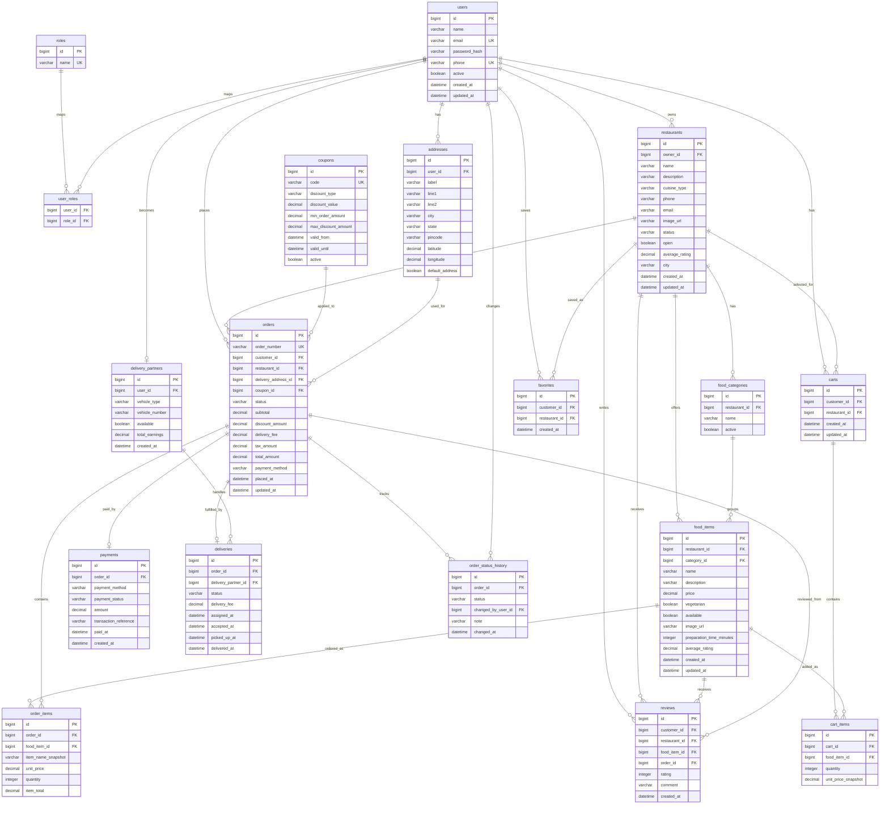

# FoodHub Database Design

## Database Goals

The FoodHub database is normalized for transactional food-ordering workflows. It separates users, restaurants, menu data, carts, orders, payments, reviews, favorites, delivery records, coupons, addresses, and order status history.

Design priorities:
- Avoid duplicated user and order data.
- Keep order totals immutable after order creation.
- Support role-based ownership.
- Support pagination and filtering.
- Preserve order status history for tracking and auditing.
- Use indexes for frequently searched columns.

## Entity Relationship Diagram

## Entity Relationship Explanation

### User and Role

`User` stores authentication and profile information. `Role` stores role names such as `CUSTOMER`, `RESTAURANT_OWNER`, `DELIVERY_PARTNER`, and `ADMIN`.

Relationship:
- `User` to `Role` is many-to-many through `user_roles`.
- This allows a user to have more than one role if needed, while still supporting simple single-role registration flows.

### User and Address

Each customer can maintain multiple delivery addresses.

Relationship:
- `User` to `Address` is one-to-many.
- `Address` belongs to exactly one user.
- One address can be marked as default per customer at the application level.

### User and Restaurant

Restaurant owners create and manage restaurants.

Relationship:
- `User` to `Restaurant` is one-to-many.
- `Restaurant.owner_id` references the owner user.
- Restaurant approval is controlled through `status`.

### Restaurant, FoodCategory, and FoodItem

Each restaurant has its own menu categories and food items.

Relationships:
- `Restaurant` to `FoodCategory` is one-to-many.
- `Restaurant` to `FoodItem` is one-to-many.
- `FoodCategory` to `FoodItem` is one-to-many.
- `FoodItem` belongs to one restaurant and one category.

This keeps menus isolated by restaurant and supports filtering by cuisine, category, availability, and keyword.

### Cart and CartItem

A cart belongs to a customer and is associated with one restaurant at a time.

Relationships:
- `User` to `Cart` is one-to-many.
- `Cart` to `CartItem` is one-to-many.
- `CartItem` references a `FoodItem`.
- `Cart.restaurant_id` helps enforce the common food-delivery rule that a cart contains items from one restaurant.

`unit_price_snapshot` can be used to display the price at the time the item was added. Final order pricing is still recalculated on the backend during checkout.

### Order and OrderItem

An order is created from a validated cart.

Relationships:
- `User` to `Order` is one-to-many.
- `Restaurant` to `Order` is one-to-many.
- `Order` to `OrderItem` is one-to-many.
- `OrderItem` references `FoodItem`, but also stores item name and price snapshots.

Snapshot fields protect historical orders from changing when a restaurant later edits menu names or prices.

### Payment

Payment is modeled separately from order.

Relationship:
- `Order` to `Payment` is one-to-one.

For this demo project, payment uses mock methods:
- `CASH_ON_DELIVERY`
- `MOCK_UPI`
- `MOCK_CARD`

No real payment gateway credentials are required.

### Coupon

Coupons can be applied during checkout if valid.

Relationship:
- `Coupon` to `Order` is one-to-many.
- An order can have zero or one coupon.

Coupon validation is performed in the service layer using active status, validity dates, minimum order amount, discount type, and maximum discount rules.

### Review

Customers can review restaurants and food items after ordering.

Relationships:
- `User` to `Review` is one-to-many.
- `Restaurant` to `Review` is one-to-many.
- `FoodItem` to `Review` is optional many-to-one.
- `Order` to `Review` is many-to-one.

Reviews should be allowed only for completed customer orders.

### Favorite

Favorites allow customers to save restaurants.

Relationships:
- `User` to `Favorite` is one-to-many.
- `Restaurant` to `Favorite` is one-to-many.

A unique constraint on `customer_id` and `restaurant_id` prevents duplicate favorites.

### DeliveryPartner and Delivery

Delivery partners are users with delivery-specific profile details.

Relationships:
- `User` to `DeliveryPartner` is one-to-one.
- `DeliveryPartner` to `Delivery` is one-to-many.
- `Order` to `Delivery` is one-to-one.

Delivery status is separate from order status but updates may also move the order workflow forward.

### OrderStatusHistory

Every important status change is stored in `order_status_history`.

Relationships:
- `Order` to `OrderStatusHistory` is one-to-many.
- `changed_by_user_id` references the user who caused the status change.

This supports order tracking and admin audit views.

## Planned Constraints

Unique constraints:
- `users.email`
- `users.phone`
- `roles.name`
- `restaurants.owner_id, restaurants.name`
- `food_categories.restaurant_id, food_categories.name`
- `coupons.code`
- `orders.order_number`
- `favorites.customer_id, favorites.restaurant_id`
- `delivery_partners.user_id`
- `payments.order_id`
- `deliveries.order_id`

Important not-null constraints:
- User name, email, password hash, active flag.
- Role name.
- Restaurant owner, name, status, open flag.
- Food item restaurant, category, name, price, availability.
- Cart customer.
- Cart item cart, food item, quantity.
- Order customer, restaurant, address, status, totals, payment method.
- Order item order, food item, item name snapshot, unit price, quantity, item total.
- Payment order, method, status, amount.

## Planned Indexes

Recommended indexes:
- `idx_users_email`
- `idx_restaurants_city`
- `idx_restaurants_cuisine_type`
- `idx_restaurants_status`
- `idx_restaurants_open`
- `idx_food_items_restaurant_id`
- `idx_food_items_category_id`
- `idx_food_items_available`
- `idx_orders_customer_id`
- `idx_orders_restaurant_id`
- `idx_orders_status`
- `idx_orders_placed_at`
- `idx_reviews_restaurant_id`
- `idx_reviews_food_item_id`
- `idx_deliveries_partner_id`
- `idx_deliveries_status`
- `idx_order_status_history_order_id`

## Enum Values

### RoleName

- `CUSTOMER`
- `RESTAURANT_OWNER`
- `DELIVERY_PARTNER`
- `ADMIN`

### RestaurantStatus

- `PENDING_APPROVAL`
- `APPROVED`
- `REJECTED`
- `SUSPENDED`

### OrderStatus

- `PLACED`
- `CONFIRMED`
- `PREPARING`
- `READY_FOR_PICKUP`
- `OUT_FOR_DELIVERY`
- `DELIVERED`
- `CANCELLED`
- `REJECTED`

### PaymentMethod

- `CASH_ON_DELIVERY`
- `MOCK_UPI`
- `MOCK_CARD`

### PaymentStatus

- `PENDING`
- `SUCCESS`
- `FAILED`
- `REFUNDED`

### DiscountType

- `PERCENTAGE`
- `FLAT`

### DeliveryStatus

- `ASSIGNED`
- `ACCEPTED`
- `PICKED_UP`
- `DELIVERED`
- `CANCELLED`

